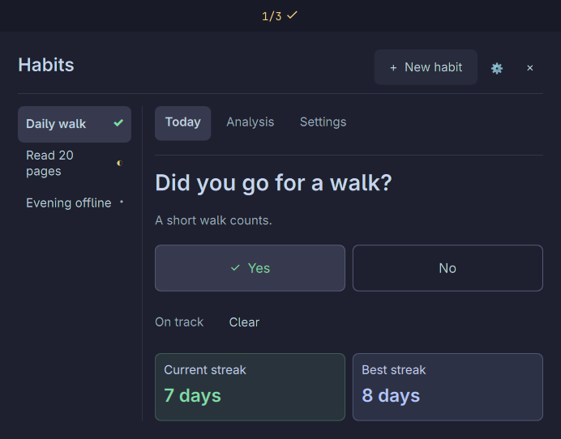
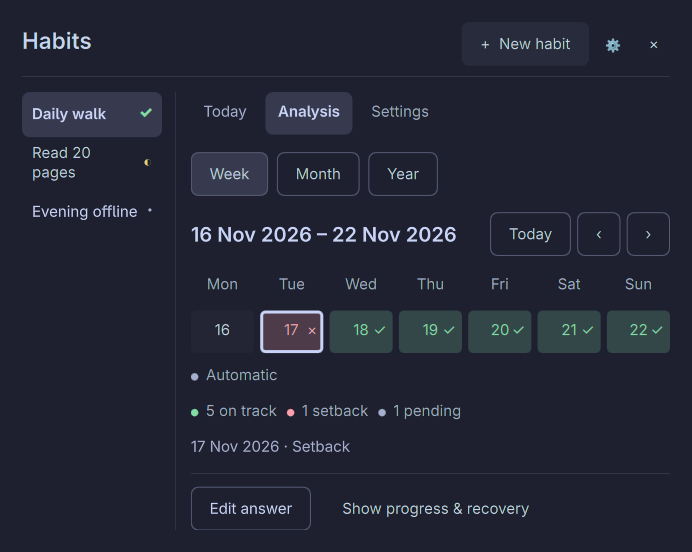
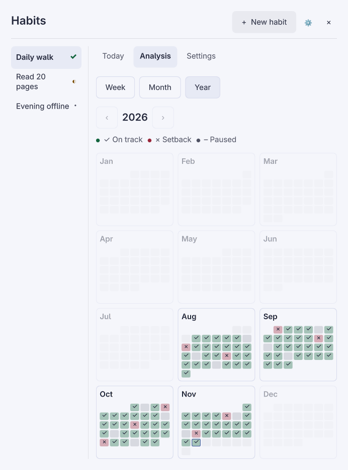

# Habit Tracker for Omarchy

Check in from the Omarchy bar and see what helped you stay on track. Track a habit you want to build, one you want to quit, or a number you want to reach. Everything stays on your computer.

[Install](#install) · [Use](#use) · [Data and removal](#data-and-removal) · [Development](#development)

## Screenshots



| Weekly analysis | Year overview |
| --- | --- |
| [](docs/screenshots/week.png) | [](docs/screenshots/year.png) |

*Rendered with the Quattro UI kit and fictional habit history. The live widget follows your Omarchy theme.*

## Install

**Requires:** Omarchy 4.5 with the Quattro bar and Python 3.11+ (standard library only). No account, extra package, separate service, or elevated permissions are required. Node.js is only needed for development.

Review the source before enabling the plugin. Omarchy plugins run with your user permissions, not in a sandbox. With access to the repository, use Omarchy's normal confirmation and placement prompts:

```sh
omarchy plugin add https://github.com/smmmsmo/omarchy-habits.git --enable
```

Click the checkmark in your bar, then choose **New habit**. Use `omarchy bar move mo.habits --section right` to reposition it. For source development, see the [isolated test guide](docs/development.md).

## Use

- **Left-click** or **middle-click** the checkmark to open the selected habit’s **Today** tab. The compact layout shows your habits on the left and **Today**, **Analysis**, and **Settings** for the selected habit on the right. Clicking a habit always opens its check-in for today. Very narrow displays use a selector instead. **Right-click** opens the selected habit’s **Settings**.
- **Current streak** and **Best streak** are visible on the habit’s check-in. On a sufficiently opaque bar, the widget uses green when all due habits are on track, amber for partial progress, and rose for setbacks. Pending or transparent bars keep the theme’s text color.
- In **Today**, log an answer or count for the selected habit. **Undo last check-in** is available for your most recent change before midnight. The bar counts on-track habits out of those due today.
- Use **New habit** to choose the type, starting date, question, and optional message. Choose **Build** or **Quit** for Yes/No check-ins; choose **Track a number** for a daily whole-number target, such as 20 pages. Numeric habits don't use automatic answers. Edit the habit under **Settings**; use a new habit if you want to switch between Yes/No and numeric tracking.
- Choose a starting date of today or earlier. Optionally set an **Ending date** in Settings. The habit shows days left and elapsed calendar days in **Today** and **Analysis**. The end date is included. Once it passes, the habit stays in the picker for history but no longer accepts current check-ins or contributes to the bar count.
- The gear opens **App settings**. Use **Week starts on** to set the first column of every Analysis calendar. Monday is the default; any weekday works. This does not change habit dates or answers.
- Ask whether the behavior happened. For **Build**, Yes is on track; for **Quit**, No is on track.
- Open **Analysis → Week** for seven days and counts of on-track, setback, and pending days; **Month** for the detailed calendar; or **Year** for all twelve months. In Week or Month, choose a day to open its check-in, with the date shown above it.
- **Show progress & recovery** opens the selected habit’s 7-day, 30-day, and since-start rates, manual and automatic counts, and recovery details.
- **Tab** moves between controls. On the calendar, arrow keys move by day or week, **Home** returns to today, and **Enter** opens that day’s answer. **Esc** leaves editing or closes the popup.
- Choose **Archive habit** in its **Settings** to pause it without deleting history. In **App settings → Archive**, you can view its read-only history or **Restore** it.

## How the numbers work

A default (Yes or No) is applied to untouched days **after they end in your local timezone**, even if the shell was closed. Today stays pending until you answer or the day ends. You can also choose **Leave pending**. Past starting dates show a backfill preview; saving does not overwrite existing answers. Changing the default preserves all previously recorded answers. Use **Clear** or **Use default** to remove a manual answer from a day.

The calendar uses ✓ and green for on track, × and red for a setback, and ◐ and amber for a numeric count that's still in progress today. A corner dot means an answer was automatic. The colors adapt to light and dark themes. Rates include scored answers, including defaults. Pending days break streaks, except today while it is still open. Archived days without an answer are paused rather than backfilled, and neither add to nor break a streak. A recovery runs from the first setback in a sequence to the next on-track answer. It is labeled if that return was automatic.

For a numeric habit, meeting the target is on track. A saved count below the target stays in progress today and counts as a setback tomorrow. No count stays pending, which is different from recording zero. Changing the target re-scores old counts without changing them. Editing the starting or ending date filters history without deleting it. Defaults and metrics stop at the ending date; the 7- and 30-day rates for a finished habit are measured back from its last day. Changing between Build and Quit re-scores existing answers. Deleting a habit requires confirmation and removes its answers.

## Data and removal

In **App settings → Export progress**, choose **CSV** for a spreadsheet-friendly log of recorded answers and counts, or **JSON** for a full snapshot including settings, messages, archived habits, and history. Exports are separate owner-only files under `$XDG_STATE_HOME/omarchy/habits-exports` (defaults to `~/.local/state/omarchy/habits-exports`). The popup shows the saved path. The plugin does not send or upload exports.

Data stays in `$XDG_STATE_HOME/omarchy/habits.json` (defaults to `~/.local/state/omarchy/habits.json`). The data and backups are written with `0600` permissions. `habits.json.bak` keeps the preceding data revision. Migration keeps an additional `habits.json.v1.bak` or `habits.json.v2.bak` with the original file, depending on the previous format. There is no network access.

The plugin uses no analytics, network APIs, or third-party storage. Habit data stays out of command-line arguments. Read the [security and privacy notes](SECURITY.md) before sharing a screenshot, log, or export.

```sh
omarchy plugin update mo.habits  # Update a Git-managed install
omarchy plugin disable mo.habits # Hide without uninstalling
omarchy plugin remove mo.habits  # Uninstall through Omarchy's confirmation prompt
```

Removal leaves history, backups, and exports alone. To erase them too, review the files first, then follow the [local cleanup steps](SECURITY.md#permanent-local-removal).

## Development

```sh
./test/all
```

The offline suite uses Python and Node.js. If Omarchy is installed, it also runs `omarchy plugin validate`.

- [AGENTS.md](AGENTS.md) — file map, invariants, and handoff checklist
- [Development guide](docs/development.md) — storage flow, smoke test, and screenshot workflow
- [Marketplace submission](SUBMISSION.md) · [Release notes](docs/release.md) · [MIT license](LICENSE)
