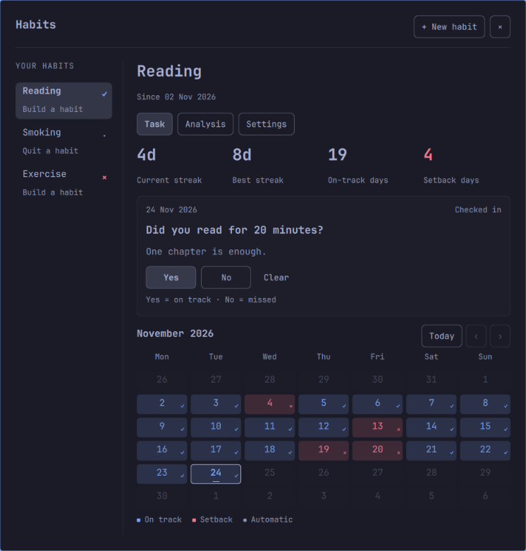

# Habits for Omarchy

A private, offline bar plugin for building habits and quitting unwanted behaviors. Each habit has its own calendar, check-in, and progress report.



## Install

Requires Omarchy 4.5 with its Quickshell bar and `python3`. The tests use Node.js; the plugin does not.

From a local checkout:

```sh
omarchy plugin validate .
plugin_dir="${XDG_CONFIG_HOME:-$HOME/.config}/omarchy/plugins/mo.habits"
mkdir -p "$plugin_dir"
install -m 644 manifest.json BarWidget.qml HabitPanel.qml StartDatePicker.qml Model.js store.py "$plugin_dir"
install -Dm 644 i18n/en.json "$plugin_dir/i18n/en.json"
omarchy-shell shell rescanPlugins
omarchy plugin enable mo.habits --section centerEnd
```

Run the same commands to update a manual installation. If the running shell has cached an older component, run `omarchy restart shell`. Once the repository is hosted, Omarchy can also install tracked checkouts with `omarchy plugin add <git-url> --enable` and update them with `omarchy plugin update mo.habits`.

## Use

- **Left-click** the checkmark to reopen the last habit’s **Task** tab with today selected. **Right-click** opens its **Settings**. The bar count is today’s on-track habits / all active habits.
- Choose a habit in the sidebar (or selector on narrow screens). Today’s status is separate for each habit.
- Use **New habit** to choose the type, starting date, question, optional message, and what to do with untouched days. Edit those same fields later under **Settings**.
- For the starting date, type `DD MMM YYYY` or select **Choose date**. The picker only allows today and earlier dates.
- Ask whether the behavior happened. For **Build**, Yes is on track; for **Quit**, No is on track.
- Click a day to view or change its answer. The month arrows browse history; **Today** returns you to the current date.
- **Tab** moves between controls. On the calendar, arrow keys move by day or week, **Home** returns to today, and **Enter** focuses the answer. **Esc** leaves editing or closes the popup.
- **Analysis** shows the selected habit’s 7-day, 30-day, and since-start rates, how many answers were manual or automatic, and recovery details.

## How the numbers work

A default (Yes or No) is applied to untouched days **after they end in your local timezone**, even if the shell was closed. Today stays pending until you answer or the day ends. You can also choose **Leave pending**. Past starting dates show a backfill preview; saving does not overwrite existing answers. Changing the default preserves all previously recorded answers. Use **Clear** or **Use default** to remove a manual answer from a day.

The calendar marks an on-track answer with ✓ and a setback with ×. A corner dot means it was automatic. Rates include only answered days (including defaults). Pending days break streaks, except today while it is still open. A recovery runs from the first setback in a sequence to the next on-track answer. It is labeled if that return was automatic.

Editing the starting date filters history without deleting it. Changing the habit type changes how existing Yes/No answers are scored. Deleting a habit requires confirmation and removes its answers.

## Data and removal

Data stays in `$XDG_STATE_HOME/omarchy/habits.json` (defaults to `~/.local/state/omarchy/habits.json`). The data and backups are written with `0600` permissions. `habits.json.bak` keeps the preceding data version; `habits.json.v1.bak` keeps the original pre-migration file for older installs. There is no network access.

`omarchy plugin disable mo.habits` hides the widget without deleting anything. For a manual install, remove its plugin directory after disabling it. For an Omarchy-managed Git install, use `omarchy plugin remove mo.habits`. Neither removes saved history.

## Development

```sh
node tests/model.test.cjs
python3 -B tests/test_store.py
omarchy plugin validate .
```

See [release notes and validation](docs/release.md).
