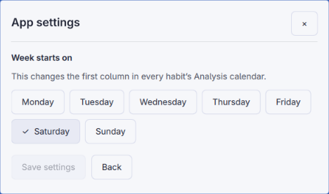
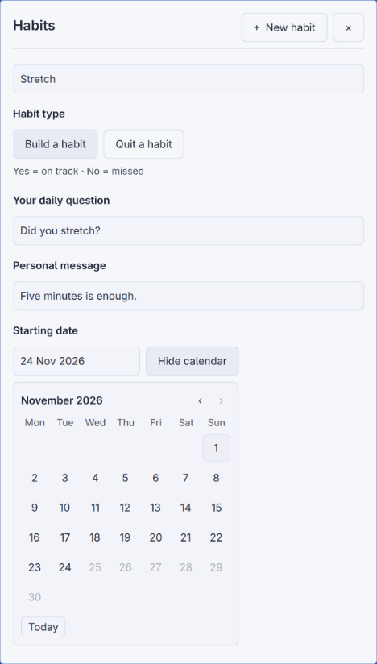

# 1.6.4 — Marketplace preparation

- Uses a Marketplace-compatible default bar section for new installations; no change to existing placement.
- Check-in data is now sent to the helper on standard input rather than through command-line arguments.
- Adds a repeatable fictional-data Quattro demo, fresh screenshots, and development and submission guides.

# 1.6.3 — Today is the selected habit’s check-in

- Clicking a habit opens its **Today** tab. Each habit has **Today**, **Analysis**, and **Settings**; the separate all-habits overview is gone.

# 1.6.2 — Streaks at a glance

- Current and best streaks are visible on each habit’s check-in. The bar uses theme-aware status colors when they have sufficient contrast.
- The archive is in **App settings**, leaving Today as a summary only.

# 1.6.1 — A read-only Today summary

- Today keeps the sidebar visible in the split layout and shows the four daily status counts. Questions, answers, numeric logging, and Undo are only shown in the relevant habit’s check-in.

# 1.6.0 — End dates and weekly analysis

- The bar opens the compact split view, with the habit list on the left and the selected check-in on the right. Click a habit name to open its check-in; Today remains available as a tab.
- An optional, inclusive ending date adds a countdown and elapsed-days meter. Finished habits keep their history, but no longer get automatic answers or count in Today.
- **Analysis → Week** uses the configured first weekday and shows on-track, setback, and pending days across the selected week.

# 1.5.0 — Today, archive and numeric targets

- Left-click opens **Today** for inline check-ins and same-day Undo; middle-click still opens the focused **Task** view.
- Archive or restore habits without clearing their history. Blank dates while archived are paused, not automatically filled.
- **Analysis → Year** shows a color-coded overview; choose a month to inspect days or edit an answer.
- Create an optional numeric habit with a daily target and unit. Yes/No habits still work as before.
- **App settings → Export progress** saves a local CSV log or a full JSON snapshot. No accounts, network requests, or external packages were added.
- V3 storage reads V1 and V2, preserving old answers and settings and retaining the original as a migration backup.

# 1.4.1 — First weekday

**App settings → Week starts on** sets the first column of every Analysis calendar. Any of the seven weekdays can be selected. Monday is the default. This replaces the app-wide habit start date; per-habit dates and history are unchanged.

## 1.4.0 — App settings

The gear opens app-wide preferences, separate from a habit’s Settings tab. New habits can start on the day they’re created or use a fixed date you set. This only fills in the new habit form; existing dates and history aren’t changed.

## 1.3.5 — Date controls and calendar colors

Starting dates use separate Day, Month, and Year menus. Each menu closes after selection; the selected date stays valid as the month or year changes. The Analysis calendar now marks on-track days green and setbacks red, with checkmarks and crosses as well as color.

## 1.3.4 — Less repetition

Habit names appear in one place: the sidebar, the narrow-layout picker, or the title for a single habit. Task shows a full date only when editing an earlier answer. Analysis relies on the highlighted calendar day instead of printing its full date again. Type is slightly smaller; the Yes/No hit areas are unchanged.

## 1.3.3 — Smaller type

Base text sizes are now 12 px for secondary labels, 13 px for body and navigation, 14 px for Yes/No, 17 px for headings, and 20 px for the question and key numbers. The typeface, popup width, and Yes/No hit areas are unchanged.

## 1.3.2 — Compact typography

The popup uses Adwaita Sans when installed, with a system sans-serif fallback. A shared scale covers 13 px supporting text, 15 px body and navigation, 16 px Yes/No, 20 px headings, and 24 px questions and key numbers. These are logical pixels and grow with larger Omarchy fonts. The compact popup width is unchanged.

References: [OpenAI’s frontend design guide](https://developers.openai.com/blog/designing-delightful-frontends-with-gpt-5-4), [OpenAI’s UI guidelines](https://developers.openai.com/apps-sdk/concepts/design-guidelines), and [Anthropic’s frontend-design skill](https://github.com/anthropics/skills/blob/main/skills/frontend-design/SKILL.md). The sizes are local design decisions, not sizes prescribed by those guides.

## 1.3.1 — Smaller popup

The popup is about one-third narrower at the previous default size. Padding and row heights are smaller, while body text and the three-tab layout are unchanged.

## 1.3.0 — A focused daily check-in

**Task** shows the question and large Yes/No controls. The calendar is in **Analysis**. Choose a date there to edit its answer in Task, or expand **Show progress & recovery** for the report. The popup uses larger proportional type and adapts its height to the active view.

## 1.2.0 — Habit tabs and date picker

Each habit has three tabs: **Task** (Yes/No and calendar), **Analysis** (rates, streaks, and recovery), and **Settings** (setup and defaults). New habits and existing settings share a date picker that opens only when needed; the date can still be typed.

## 1.1.0 — Calendar and per-habit analysis

The calendar opens to the last viewed habit, with today’s Yes/No check-in above the date grid. On narrow screens the sidebar becomes a selector. A separate Analysis tab reports rates, counts, and recovery for that habit only.

This version keeps existing manual answers and carries the old shared starting date into each existing habit. It does not guess automatic answers during migration. An existing habit starts using automatic answers only after you choose a setting for it.

## Release checks

- Run `./test/all` and the [Quattro UI smoke test](development.md).
- In a test profile, set up three habits with different start dates and answers. Verify sidebar status, per-habit reports, calendar markers, editing an automatic answer, and picking a different default without rewriting saved history.
- Restart the shell after changing the selected habit. Verify selection and history are preserved.
- Check a narrow popup, a light and dark theme, Tab/Enter navigation, month bounds, and the visible backfill preview before saving.
- In both Settings and New habit, choose a past start date, verify the menus close after selection, and check that future dates cannot be selected.
- Review both screenshots for demo data only. Create a versioned release from a clean repository, without committing or including personal state.

Known scope: one Yes/No answer or numeric count per habit per local day, no syncing, no reminders, and no medical interpretation. An automatic default is an assumption, not confirmation that the behavior happened.
