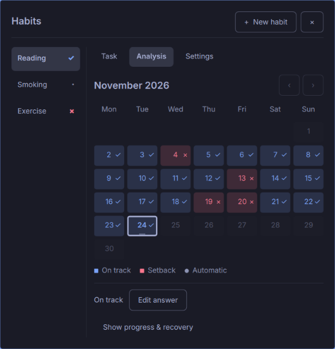

# 1.3.4 — Less repetition

Habit names appear in one place: the sidebar, the narrow-layout picker, or the title for a single habit. Task shows a full date only when editing an earlier answer. Analysis relies on the highlighted calendar day instead of printing its full date again. Type is slightly smaller; the Yes/No hit areas are unchanged.

## 1.3.3 — Smaller type

Base text sizes are now 12 px for secondary labels, 13 px for body and navigation, 14 px for Yes/No, 17 px for headings, and 20 px for the question and key numbers. The typeface, popup width, and Yes/No hit areas are unchanged.

## 1.3.2 — Compact typography

The popup uses Adwaita Sans when installed, with a system sans-serif fallback. A shared scale covers 13 px supporting text, 15 px body and navigation, 16 px Yes/No, 20 px headings, and 24 px questions and key numbers. These are logical pixels and grow with larger Omarchy fonts. The compact popup width is unchanged.

References: [OpenAI’s frontend design guide](https://developers.openai.com/blog/designing-delightful-frontends-with-gpt-5-4), [OpenAI’s UI guidelines](https://developers.openai.com/apps-sdk/concepts/design-guidelines), and [Anthropic’s frontend-design skill](https://github.com/anthropics/skills/blob/main/skills/frontend-design/SKILL.md). The sizes are local design decisions, not sizes prescribed by those guides.

## 1.3.1 — Smaller popup

The popup is about one-third narrower at the previous default size. Padding and row heights are smaller, while body text and the three-tab layout are unchanged.

## 1.3.0 — A focused daily check-in

**Task** shows the question and large Yes/No controls. The calendar is in **Analysis**. Choose a date there to edit its answer in Task, or expand **Show progress & recovery** for the report. The popup uses larger proportional type and adapts its height to the active view.

## 1.2.0 — Habit tabs and date picker

Each habit has three tabs: **Task** (Yes/No and calendar), **Analysis** (rates, streaks, and recovery), and **Settings** (setup and defaults). New habits and existing settings share a date picker that opens only when needed; the date can still be typed.

## 1.1.0 — Calendar and per-habit analysis

The calendar opens to the last viewed habit, with today’s Yes/No check-in above the date grid. On narrow screens the sidebar becomes a selector. A separate Analysis tab reports rates, counts, and recovery for that habit only.

This version keeps existing manual answers and carries the old shared starting date into each existing habit. It does not guess automatic answers during migration. An existing habit starts using automatic answers only after you choose a setting for it.

## Release checks

- Run `node tests/model.test.cjs`, `python3 -B tests/test_store.py`, and `omarchy plugin validate .`.
- In a test profile, set up three habits with different start dates and answers. Verify sidebar status, per-habit reports, calendar markers, editing an automatic answer, and picking a different default without rewriting saved history.
- Restart the shell after changing the selected habit. Verify selection and history are preserved.
- Check a narrow popup, a light and dark theme, Tab/Enter navigation, month bounds, and the visible backfill preview before saving.
- In both Settings and New habit, choose a past date from the picker, check that future days are disabled, and confirm typing still works.
- Review both screenshots for demo data only. Create a versioned release from a clean repository, without committing or including personal state.

Known scope: one Yes/No answer per habit per local day, no syncing, no reminders, and no medical interpretation. The default is an assumption, not confirmation that the behavior happened.
